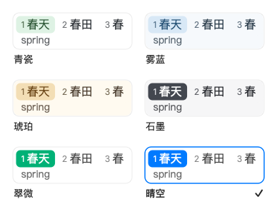

# 鼠须管·学英语

从 Mac 菜单栏的输入法列表里选 **鼠须管·学英语**，就能用小鹤双拼打中文。短候选排成一行；一行放不下时，按实际字宽均分到尽量少的几行，保留原来的顺序和选词数字。圆角底色标出当前选词。译文就绪才展开，不占候选位置。**不用按 F4，也不用打开配置文件。**

| 想输入什么 | 怎么做 |
| --- | --- |
| 中文原文 | 照常打小鹤双拼，按空格选当前候选。比如打 `pkgo`，空格输入「苹果」。 |
| 一句里夹英文 | 连打 `woysdockerbuuu`，看到第一候选「我用docker部署」，只在句尾按一次空格。中间不用切英文、按回车或选字；关掉翻译预览也能混输。 |
| 英文译文 | 同样打 `pkgo`，等数字「1」下方出现 `apple`，按 **⌥ Option + 回车** 输入看到的译文。 |
| 只预览第几个中文候选 | 按 **Control + 1～6** 跳到本页相应候选，只换高亮和下方译文，不上屏。比如按 **Control + 4** 看第 4 项，再按空格才确认中文。 |
| 从几个英文意思里选一个 | 高亮「地方」，下方显示 `1 place 地点　2 part 部分　3 locality 行政区`。按 **⌥2** 只输入 `part`；按 **⌥ 回车** 输入第一项 `place`。不按 ⌥ 的数字仍选中文。 |
| 从英文补全或中文义项里选 | 英文模式里打 `translat`，第 1 项保留原文；**Control + 数字**预览本页英文，**空格或回车**确认高亮的英文，**Option + 数字**输入下排对应的中文。例如开大写锁定打 `LLM`，可在「大语言模型」和「法学硕士」之间选。普通数字照常打，`GPT4` 不会选词。 |
| 输入英文原文 | 高亮的是你打的完整英文（例如 `LLM`）时，按一次**空格或回车**确认当前项，默认是原文，不附带空格或换行，不必按 1。确认后再按空格或回车，才交给编辑器。 |
| 把英文翻成中文 | 轻按 **Shift** 切到英文模式。输入英文单词后，按 **⌥ 回车**输入中文译文。翻整句时，第一个词间空格用 **Shift + 空格**，后续词间空格照常打；回车确认英文原句，Esc 取消。 |
| 暂时不要翻译 | 点菜单栏的输入法图标，取消勾选 **翻译预览**；再点一次恢复。关闭后，英文模式直接输入字母。 |
| 换候选条颜色 | 在菜单栏点学习版图标，选 **主题**。选「晴空」可用白底蓝色高亮，夜间自动换成深灰底、柔和的蓝色高亮。其他配色有青瓷、雾蓝、琥珀、石墨和翠微。选好后立即生效，深浅色随系统切换。 |




中文预览优先查本机《汉英大词典（第三版）》的**完整候选**，既查词头，也查原书有直接英文对应的短搭配。例如「收拾桌子」直接给 `clear the table`；「看看」没有收录为可直接输入的整条译法，就把「看看」原样交给 Apple 翻译。「帮我看看这段代码」同样整句翻，不先查「看」再拼起来。候选条最多列三项；看完整释义和例句，请打开 macOS「词典」。未装这本词典时仍可正常使用本机翻译。

英文补全使用白霜英文词表，构建时按仓库已有的 Easy English 词频排序；没有匹配时只显示原文。英文单词或完整词组先查本机朗文索引，最多显示三个可上屏的中文释义；未收录的内容用 Apple 整体翻译。开发用语 `LLM` 优先显示「大语言模型」。中文模式下单独输入全大写缩写时，同样可用英文候选；已在组词的中文保留原来的混输方式。

在 Sublime Text 里，候选窗显示时，**Control + 3** 只预览上排第 3 项。例如打 `LLM`，再按 **Control + 3**，高亮移到 `large language model`；按空格才输入。候选窗关闭后，**Control + 3** 仍用来切到第 3 个分栏。

Apple 翻译返回的词和短语尽量按词条写法显示，例如 `deoxyribose and`；完整句子和无法确定大小写的名称沿用本机译文。英译中时，译文对齐英文原文的第一个字母。

翻页后，单字也有译文。例如打 `qkdj`，用方向键选中第二页的「清」，预览翻译「清」，不把后面的 `dj` 当作英文。此时按 ⌥ 回车只输入当前译文，剩下的 `dj` 仍可继续选字。

只预览仍在输入法里、尚未确认的文字。译文未就绪时按 ⌥ 回车，不会误用上一句或发送消息。密码框开启系统安全输入时不翻译。

## 它只做两件事

- **小鹤双拼**：一个方案，保留普通中文选词、标点和常用字首选；不加载辅助码、反查、计算器、日期、表情或 Lua 插件。词典来自白霜拼音官方仓库，保留你在学习版已积累的选词记录；不读取原版鼠须管的个人词频或私有短语。
- **学英语**：原生候选窗下方多一行，中文先查本地汉英索引，未命中和英译中使用 [Apple 本机翻译](https://developer.apple.com/documentation/translation/translationsession)，不用剪贴板，不请求云端。连续输入时不留空行，也不显示加载字样。中文按最后一键、英文按预览文字最后一次变化，等约 380 毫秒再翻译或显示缓存结果。英文整句草稿中的词间空格不会收起已有译文；输入下个词才更新。译文只向候选排外侧展开，靠近屏幕底部时可显示在候选上方。中文和英文候选都是 16 点，译文用同一字体的 14 点。首次缺语言包时，按候选条提示下载简体中文和美式英语。

## 这套词库适合打什么？

词库采用 [白霜拼音 2026-11-21 的官方版本](https://github.com/gaboolic/rime-frost/tree/0ba3f340b9a638cef41bfb377b2d376f73e3711d)：常用字、基础词、扩展词以及官方默认的专业词表都已包含，例如计算机、地名、医学和成语。只换词库，不安装白霜的额外插件，也不把小鹤改成全拼。词库随安装包提供，打字时不用联网。

中英混输使用同一版本白霜的英文主词表和补充表。完整的英文拼写可以出现在句首、中间或句尾，不是把示例句预先存成短语。为少抢中文，普通英文从四个字母起，另收 `git`、`vue`、`API` 等常用短词。两种解释都成立时优先完整中文；例如小写 `go` 仍可打「国」，语言名可输入 `Go`。生僻人名、任意变量名不保证自动识别。

## 让输入法记住你的叫法

比如项目叫「星舟」。第一次连打 `xkvzbuuu`，如果首选是「行舟部署」，就在**同一次输入**里依次选「星」「舟」「部署」。之后只打 `xkvz`，也能优先选到「星舟」；换成「星舟测试」或「星舟docker」时仍能用到这个名字。正常选词就可以，不必专门开学习模式。

个人词频沿用学习版原来的本机词库，重启仍在。新版另外学习相邻选段组合成的短词，最多六个拼写单位（一个汉字通常算一个，完整的 `docker` 也算一个）。这限制的是从多个选段里另外学哪些组合，不限制一句能打多长；超过六个单位的多个选段不保证整串都被记成新词。已经分别上屏的几条消息不会被拼成新词，取消的输入和下方的译文预览也不会因为显示过就加入词库。你原先固定的 `ma → 吗`、`de → 的` 等常用首选仍固定。

记错了不用清空词库：把候选高亮移到那个学出来的词，在 Mac 笔记本键盘按 **Shift + Fn + Delete（⌫）**，只撤销这一个词的学习记录。原理和快捷键见 [Rime 官方使用指南](https://github.com/rime/home/wiki/UserGuide)。

## 安装和回退

需要 macOS 26.4 或更新版本、包含 Translation 的 Swift SDK，以及系统目录下的鼠须管 1.1.2。构建复用原版的输入引擎和界面资源；方案、词典、输入源名称和用户目录都是独立的。

在本目录运行 `./build.sh`，生成 `dist/xiaohe-2.9.7/RimeLearning.app`。如果已有产物，用 `./build.sh <新目录>` 单独构建，不覆盖旧文件。

- **首次安装**：`./install.sh` 注册并启用学习版，不切换当前输入法。
- **升级已安装的学习版**：先确认正在输入的文字，再运行 `./update.sh "$PWD/dist/xiaohe-2.9.7/RimeLearning.app"`。脚本先备份旧学习版应用，仅在原先选中学习版时暂时切到英文键盘并在替换后恢复，不替换系统目录的原版。
- **不想用学习版**：从菜单栏直接改选原来的「鼠须管」。旧学习版应用的备份在 `~/Library/Application Support/RimeLearning/Backups/`；旧学习版的 `Profile` 保留不动，新版用同目录下的 `Xiaohe` 记录词频。原版继续使用 `~/Library/Rime`。

### 制作可选的汉英词典

准备个人持有的 `ChineseEnglish3.mdx`、同目录同名的 `.mdd` 和 `.css`，以及 Apple Dictionary Development Kit（DDK）。在本目录运行下面两步，输出位置必须是新目录：

```sh
uv run --isolated --with mdict-utils --with lxml python lexicon/prepare.py "/path/to/ChineseEnglish3.mdx" /tmp/hanying-build
cd /tmp/hanying-build
"$DICT_BUILD_TOOL_DIR/bin/build_dict.sh" -v 10.11 -c 1 -s 0 HanYing3 Book.xml Book.css Book.plist
```

`DICT_BUILD_TOOL_DIR` 指向 DDK 根目录。把生成的 `objects/HanYing3.dictionary` 放入 `~/Library/Dictionaries/`，在「词典 → 设置」中勾选；可将它放在汉语词典之前，保留朗文的英文查询优先级。学习版下次启动会读取这本书自带的英文候选索引，不依赖「词典」的勾选和排序。原书、转换包和索引均不随输入法分发。

### 给英语预览接入自己的朗文

如果已安装 LDOCE5 英汉双解版，在本目录运行下面的命令，重新启动学习版后生效。脚本只读个人安装的词典，将短释义索引放入学习版用户目录；不修改原书，也不把它装入输入法应用包。

```sh
uv run --isolated --with lxml python lexicon/prepare-longman.py "$HOME/Library/Dictionaries/LDOCE5.dictionary" "$HOME/Library/Application Support/RimeLearning/Lexicons/Longman.sqlite3"
```

### 如果在文本编辑里仍然只出现字母

看菜单栏确认当前文稿选的是「鼠须管·学英语」，不是微信输入法。如果选对了，打 `pkgo` 加空格仍只有字母，就先切回平时用的输入法，别反复按 F4。如果只是首次安装后有个别应用没接上学习版，可以等方便时保存工作，退出 Mac 账户再登录，再试一次。若仍失败，需要继续检查这台 Mac 对本地构建输入法的签名要求，不必重新配置小鹤或下载词库。

### 微信里按 Control＋空格就退出

如果只有在微信里用快捷键切换输入法才退出，先保存草稿；临时保持微信原来能用的输入法，或在没有草稿时用右上角的输入法菜单点选，不经过光标旁的快捷切换浮窗。本机微信 4.1.15 的三份报告都指向 macOS 的这个浮窗，[鼠须管社区也记录过同样的调用位置](https://github.com/rime/squirrel/issues/951)。学习版现已补全输入法本身的语言、图标声明；是否能消除微信内的快捷切换闪退，尚未在微信确认。重开应用时系统可能按文稿恢复上次的输入法，这与快捷切换时退出是两件事。

### 切换没生效，或候选条高度忽高忽低

候选窗默认直接以实际大小出现。想用系统原来的弹出效果，在菜单栏点学习版图标，勾选 **候选窗弹出动画**；下次弹出就生效，重启也会记住。这个开关只管弹出效果，译文出现时仍会正常增加一行。

在学习版的输入法菜单勾选 **状态诊断日志**，照常切换输入法或打字，再选 **显示诊断日志文件**。取消勾选就停止记录；开关在重启后保留，新安装默认关闭。

日志在 `~/Library/Logs/RimeLearning/state.jsonl`。每行是一条带本地时间的状态变化：

- `selectionNotice` 记录系统通知时读到的输入源分类，`from` 是上一次读数，`source` 是这一次；`active` / `inactive` 表示系统激活 / 停用了学习版输入会话。最后一次变化约 1.5 秒后再读一次（`settled`），用于查“切过去又跳回来”。`secure` 表示系统安全输入状态。如果输入源仍是学习版，`mode` 的 `ascii: true` 表示 Rime 自己切到了英文模式。菜单项灰着、系统没有发出切换通知时，日志看不到那次点击。
- `layout` 是候选布局，`preview` 是译文刷新。`rows` 是候选分行数；`sourceHeightPt` 是不含译文的高度，`heightPt` 是整个窗口高度（单位：点），`captionVisible` 是译文栏是否显示。只记发生变化的状态。安全输入期间不记候选布局。

不记录按键、拼写、候选、译文、剪贴板、应用名或窗口标题。日志只写本机，当前文件和上一份各最多 512 KiB。如果学习版菜单打不开，可在终端操作运行中的学习版：

```sh
ime="$HOME/Library/Input Methods/RimeLearning.app/Contents/MacOS/RimeLearning"
"$ime" --diagnostics snapshot  # 立即取样，稍后复读；不会切换输入源
"$ime" --diagnostics off       # 关闭；重新开启用 on
```

## 开发验证

`./tests/run.sh` 使用独立的临时目录。它用慢翻译模拟连续打字，并用真实小鹤候选、Apple 翻译和原生候选窗检查：开关能否工作，译文是否挤走第一候选，空格、回车和 ⌥ 回车是否各自输入正确的文字。另一个用例验证词典命中、整段翻译回退和 ⌥1–3 上屏；指定 `HAN_YING_TEST_INDEX` 可用真实词典索引代替小型测试数据。其中的 `tests/check-memory.sh` 用临时词库和多个独立进程验证记词、重启、取消和单词遗忘，也可以传入上一版应用来验证词频沿用。该脚本的接收端是测试输入框，不代替第三方应用实测。

## 来源与许可

本目录的 Swift 前端基于 Squirrel **1.1.2**（GPLv3，见 Licenses/Squirrel-GPL-3.0.txt）；此处的输入学习、测试与构建改动同样按 GPLv3 提供。C 接口头来自该版绑定的 [librime a251145](https://github.com/rime/librime/tree/a251145d3aafa33871824a40bbec04c966bd8b56)（BSD 三条款）；X11 键码头保留各自版权声明。仓库其余部分的许可不变。
